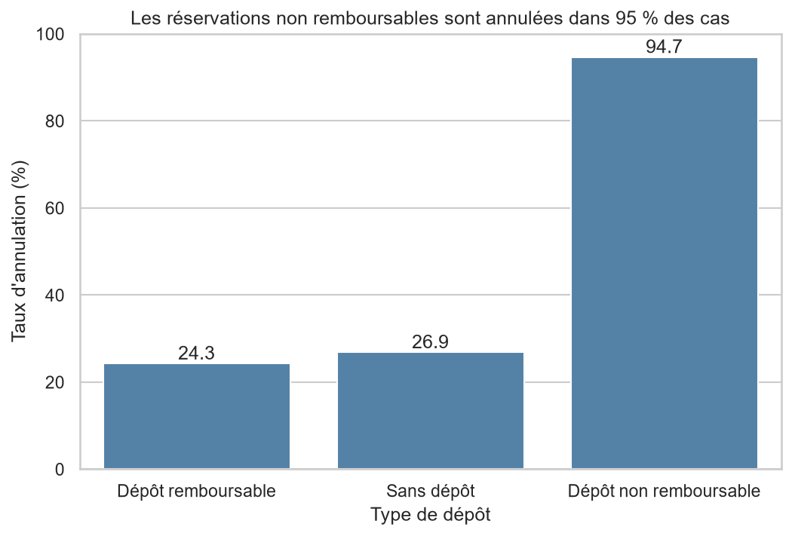
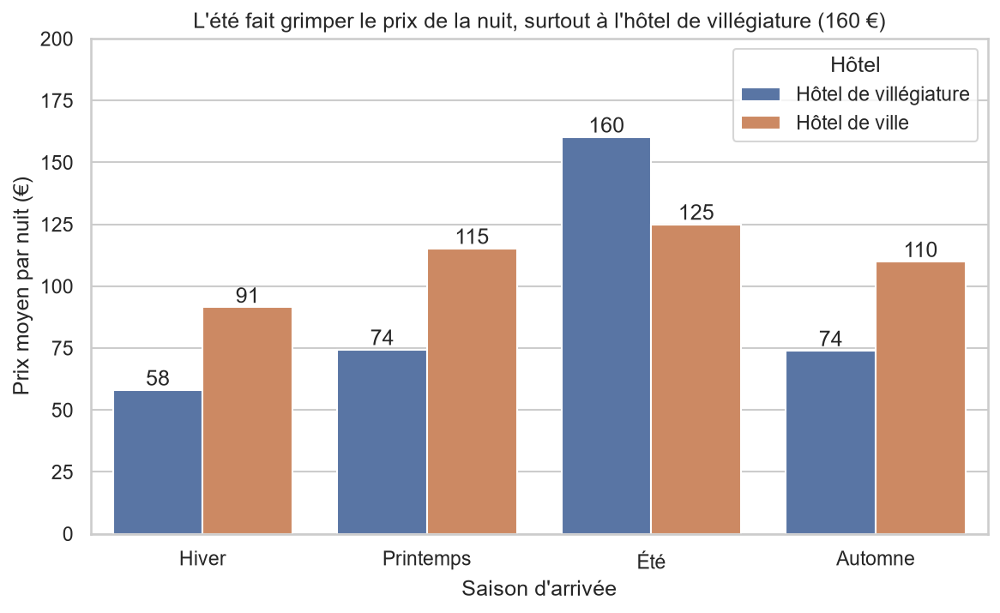
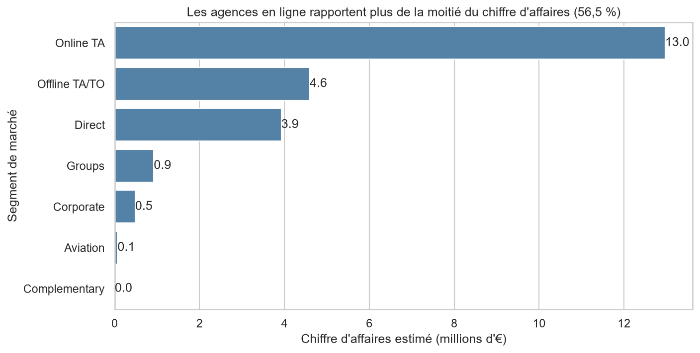

# Analyse des réservations d'hôtels

## Question étudiée

Comprendre les annulations, la demande et les revenus de deux hôtels (un hôtel de ville et un hôtel de villégiature) entre juillet 2015 et août 2017, à travers cinq questions métier :

1. Quel est le taux d'annulation, et varie-t-il selon l'hôtel et le type de dépôt ?
2. Le délai de réservation influence-t-il les annulations ?
3. Quels mois sont les plus chargés, et quel est le prix moyen par nuit selon la saison ?
4. D'où viennent les clients, et quels pays annulent le plus ?
5. Quel segment de marché rapporte le plus ?

## Source des données

- Jeu de données : Hotel Booking Demand (Kaggle), 119 390 réservations et 32 colonnes
- Origine : Antonio, de Almeida et Nunes, « Hotel booking demand datasets », Data in Brief, 2019
- Lien : https://www.kaggle.com/datasets/jessemostipak/hotel-booking-demand?resource=download
- Date de téléchargement : 09/10/2026 14:57:28
- Licence : https://creativecommons.org/licenses/by/4.0/ 

## Structure du dépôt

```
Mon-projet-Analyse/
├── data/
│   ├── raw/hotel_bookings.csv        fichier d'origine, jamais modifié
│   └── processed/hotels_propre.csv   fichier nettoyé, produit par 02_nettoyage.ipynb
├── notebooks/
│   ├── 01_exploration.ipynb
│   ├── 02_nettoyage.ipynb
│   └── 03_analyse.ipynb
├── figures/                          les graphiques enregistrés
├── src/
├── requirements.txt
└── README.md
```

## Installation

Sous Windows (PowerShell), avec Python 3.14 :

```
git clone https://github.com/fotsotagnefred-png/Mon-projet-Analyse.git
cd Mon-projet-Analyse
python -m venv .venv
.venv\Scripts\Activate.ps1
pip install -r requirements.txt
```

Sous macOS ou Linux, remplacer l'activation par `source .venv/bin/activate`.

## Ordre d'exécution

Dans VS Code, ouvrir chaque notebook, choisir le kernel `.venv`, puis lancer **Restart** et **Run All** :

1. `notebooks/01_exploration.ipynb` : questions, chargement, inspection et exploration des données brutes
2. `notebooks/02_nettoyage.ipynb` : nettoyage justifié et chiffré, crée `data/processed/hotels_propre.csv`
3. `notebooks/03_analyse.ipynb` : agrégations, jointure, analyse par mois et graphiques

## Nettoyage

119 390 lignes brutes, 86 628 lignes après nettoyage (32 762 supprimées). Chaque décision est justifiée dans `02_nettoyage.ipynb` : doublons, valeurs manquantes, valeurs « Undefined », réservations incohérentes, prix aberrants, colonnes redondantes et types.

## Principaux résultats

- 27.7 % des réservations sont annulées. Les réservations à dépôt non remboursable sont annulées dans 94.7 % des cas (1 037 réservations).
- Plus on réserve tôt, plus on annule : 8.5 % d'annulations à moins d'une semaine, 41.0 % à plus d'un an.
- Le prix moyen par nuit passe de 77.7 en hiver à 139.3 en été.
- Les clients portugais sont les plus nombreux (31.0 %) et annulent beaucoup (36.4 %), contre 18.3 % pour les Néerlandais.
- Les agences en ligne rapportent 56.5 % du chiffre d'affaires estimé.







Les six graphiques sont dans le dossier `figures/`.

## Limites de l'analyse

- 31 994 doublons supprimés faute d'identifiant de réservation : une partie (surtout des groupes) pourrait être de vraies réservations.
- Les analyses montrent des liens, pas des causes.
- La période est courte (juillet 2015 à août 2017) et le volume est plus faible en 2015.
- La devise n'est pas précisée (supposée en euros) et les séjours à prix 0 sont exclus des moyennes de prix.
- Le chiffre d'affaires est estimé (prix moyen par nuit × nombre de nuits, séjours non annulés) et ne tient pas compte des commissions des agences.
- 157 codes pays rares sont regroupés en « Autres pays » (7.0 % des réservations).